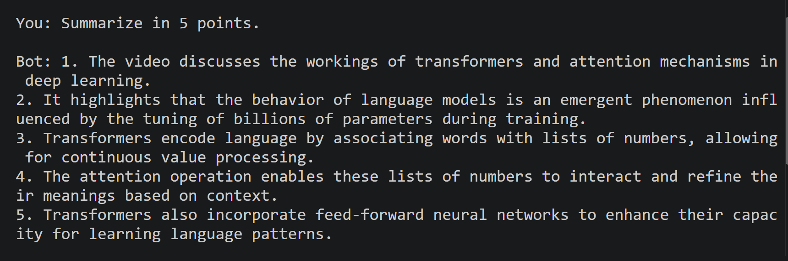
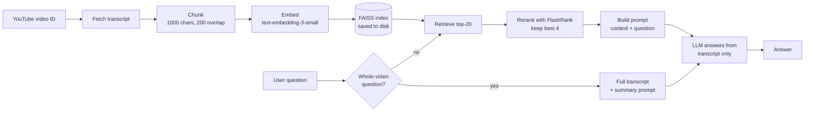

# TubeRAG: A Self-Evaluating YouTube Chatbot

Chat with any YouTube video that has English captions. Answers come only from the video's transcript, and the whole pipeline (retriever, generator, end to end) is measured with an automated evaluation suite instead of "it seems to work".




## Why this project

Most RAG demos stop at "it answered my question". This one asks whether the answer is any good, and where it fails when it isn't. The chatbot is the product. The eval suite is what makes it trustworthy: it tests the retriever and the generator separately and then together, so a bad score points at the component that caused it. Every retrieval change in this repo was kept or rejected based on those numbers (see [Experiments](#experiments)).

## How it works



| Step | Module | What it does |
|---|---|---|
| 1. Ingestion | `src/ingestion.py` | Fetches a video's transcript (any English variant), or loads `.vtt` files for evaluation |
| 2. Chunking | `src/chunking.py` | Recursive character splitting with overlap |
| 3. Embedding | `src/embedding.py` | OpenAI `text-embedding-3-small` for chunks and queries |
| 4. Vector store | `src/faiss_index.py` | Builds, saves and reloads a FAISS index, so each video is indexed once |
| 5. Retrieval | `src/reranker.py` | Top-20 similarity search, then a FlashRank cross-encoder keeps the best 4 |
| 6. Augmentation | `src/context_builder.py` | Joins chunks and fills the prompt template |
| 7. Generation | `src/generator.py` | Calls the LLM with the augmented prompt |
| 8. Pipeline | `src/pipeline.py` | `run_rag`: retrieve, build context, generate. Used by both the app and the end-to-end eval, so they can't drift apart |
| 9. Summaries | `src/summarizer.py` | Routes "summarize this video" questions to the full transcript, because top-k retrieval can't answer them |

The prompt tells the model to use only the transcript, answer directly, clean up speech-to-text errors, say what the video does not cover, and reply "I don't know based on this video." when the answer isn't there.

**Why a summary route?** Retrieval finds the few chunks most similar to a question. "Summarize the whole video" is similar to no particular chunk, so retrieval returns arbitrary passages and the model correctly says it doesn't know. Whole-video questions skip retrieval and use the full transcript instead. This route is not RAG, and the evals below cover only the RAG path.

## Evaluation

The suite uses [DeepEval](https://github.com/confident-ai/deepeval) with `gpt-4o-mini` as the judge (threshold 0.7). Three evals, each on 15 golden questions:

| Eval | File | Metrics | Tests |
|---|---|---|---|
| Retriever | `evals/eval_retriever.py` | Contextual Recall, Contextual Precision | Does the right context come back? |
| Generator | `evals/eval_generator.py` | Faithfulness, Answer Relevancy | Given known-good context, is the answer faithful and relevant? |
| Full pipeline | `evals/eval_rag_pipeline.py` | Contextual Relevancy, Faithfulness, Answer Relevancy | The real retriever and generator together |

The generator eval feeds the generator the golden context, so a low score is the generator's fault alone. The pipeline eval uses whatever the retriever actually returns. Every run saves per-question scores, retrieved chunks and the judge's reasons to `result/`, and runs with missing scores are flagged `INCOMPLETE`.

### Generator results

Averages of 2 runs on the same golden set.

| Setup | Faithfulness | Answer Relevancy |
|---|---|---|
| `gpt-6-luna`, original prompt | 0.88 | 0.89 |
| `gpt-5.6-luna`, original prompt | 0.89 | 0.89 |
| `gpt-6-luna`, prompt v2 (current) | 0.89 | 0.88 |

The more expensive model scored the same, so the cheaper one was kept. Prompt v2 is a tie on scores and was kept because answers are about 25% shorter and refusals are consistent.

### Experiments

Each retrieval change was tested alone against a baseline, run twice, and judged on one target and two guardrails. Target: pipeline Contextual Relevancy. Guardrails: retriever recall and pipeline Faithfulness must not drop. Run-to-run noise is about 0.03 to 0.05, so smaller gaps were treated as ties.

| Setup | Retriever recall | Retriever precision | Pipeline Contextual Relevancy | Pipeline Faithfulness | Pipeline Answer Relevancy | Verdict |
|---|---|---|---|---|---|---|
| **Baseline**: chunk 1000/200, k=4, no reranker | 0.90 | 0.88 | 0.44 | 0.95 | 0.89 | reference |
| Chunk 500/100, k=4 | 0.88 | 0.75 | 0.40 | 0.92 | 0.83 | **Rejected**: worse everywhere |
| **Chunk 1000/200, top-20 + reranker, k=4** | 0.91 | 0.84 | 0.42 | 0.95 | 0.90 | **Kept**: fixes real failures |
| Chunk 1000/200, top-20 + reranker, k=3 | 0.90 | 0.85 | 0.47 (1 run) | 0.82 (1 run) | 0.86 (1 run) | **Rejected**: Faithfulness dropped 0.13 |
| Chunk 1000/200, top-20 + BGE reranker (`BAAI/bge-reranker-v2-m3`), k=4 | 0.94 | 0.89 | 0.46 | 0.94 | 0.86 | **Rejected**: better retriever, no better answers |

What each result taught:

- **Smaller chunks (500) hurt.** Contextual Relevancy didn't improve, and precision fell by 0.14. With k=4 the generator saw half as much text, and one question went from answered to "I don't know".
- **The reranker fixed specific failures without moving the average.** The "regression testing" question went from recall 0 and precision 0 to 1.0 and 1.0, because its right chunks sat at ranks 7, 15 and 26 and now reach the top 4. A step-by-step prompting question went from a flat refusal to a real answer. Contextual Relevancy stayed near 0.4, because 1000-character chunks of lecture speech contain off-topic sentences whichever chunks are picked. FlashRank was chosen over an LLM reranker because the judge is also `gpt-4o-mini`, and a reranker built on the judge would inflate the score.
- **k=3 raised the target and broke a guardrail.** Contextual Relevancy rose by 0.06, but the 4th chunk often held the answer, so Faithfulness fell by 0.13.
- **A stronger reranker improved the retriever but not the answers.** Swapping FlashRank for the multilingual BGE cross-encoder (2.2 GB, run on a GPU) raised retriever recall by 0.03 and precision by 0.05. The retrieved chunks were identical across both runs, so the retriever side is stable. But pipeline Contextual Relevancy moved only 0.04 (a tie), Faithfulness held at 0.94, and Answer Relevancy fell by 0.04. The real-world-failure question lost its supporting chunks and was answered poorly in both runs. Looking at the retriever eval alone would have suggested adopting BGE; the pipeline eval is what showed it doesn't pay for its size.

The final setup is chunk 1000/200, top-20 candidates, FlashRank reranking, k=4. The rejected runs are kept in `result/experiments/`.

### Limitations

- 15 golden questions per eval, so one question moves a score by about 6.7 points.
- One judge model (`gpt-4o-mini`), so judge bias is not measured. Some golden contexts mix up similar terms (MMLU vs MMLU Pro) or don't answer their question, which makes a few items unstable and caps generator Faithfulness near 0.88.
- Contextual Relevancy stays low (about 0.4), partly because of how spoken-word chunks are written, and Answer Relevancy penalizes a correct "I don't know".
- Vague questions can retrieve poorly. For example, "what are the components of FastAPI?" returns "I don't know" because the video never lists components.
- The summary route works for transcripts that fit in the model's context, and has no eval of its own.
- Reranker comparisons used one candidate pool size (top-20). A wider pool was not tested.

## Getting started

**Requirements:** Python 3.12, [uv](https://docs.astral.sh/uv/), an OpenAI API key.

```bash
git clone https://github.com/Dhruv06000/Self-Evaluating-RAG-System.git
cd Self-Evaluating-RAG-System
uv sync
```

Create a `.env` file in the project root:

```
OPENAI_API_KEY=your_key_here
```

**Chat with a video.** Set `VIDEO_ID` in `main.py` (the ID only, e.g. `foGklduxhM0` from `youtube.com/watch?v=foGklduxhM0`), then:

```bash
uv run python main.py
```

The first run downloads the reranker model (about 22 MB), fetches the transcript, and builds and saves the index under `data/<VIDEO_ID>`. Later runs load it instantly.

**Run the evals** (they call the OpenAI API and cost money):

```bash
uv run python -m evals.eval_retriever
uv run python -m evals.eval_generator
uv run python -m evals.eval_rag_pipeline
```

The retriever and pipeline evals read `.vtt` transcript files from `knowledge_base/`, which is not included in the repo (the transcripts belong to their course). Put your own `.vtt` files there and write golden questions for them. Delete `data/knowledge_base_index` whenever you change the chunk size or embedding model.

## Project structure

```
.
├── main.py                 # YouTube chat loop
├── src/                    # RAG pipeline, one module per step
├── evals/                  # eval scripts and shared harness
├── goldens/                # golden question sets
├── result/                 # saved eval runs (per-question scores and reasons)
│   └── experiments/        # rejected experiments, kept for reference
├── docs/                   # screenshots
├── data/                   # saved indexes, cached transcripts (gitignored)
└── knowledge_base/         # your .vtt transcripts for evals (gitignored)
```

## Roadmap

Planned, not built yet:

- **Cited answers:** show the supporting excerpts with every answer, then link them to timestamps in the video.
- **Easier input:** accept full YouTube URLs, take the video at startup, and handle missing captions and API errors cleanly.
- **Chat memory** with history-aware query rewriting, so follow-up questions work.
- **Wider input:** Hindi transcripts via translation, a Whisper fallback for videos without captions, and the same pipeline for PDF, Word, Markdown and web pages with a common metadata schema.
- **Browser extension:** a side panel on the YouTube page that chats with the video you're watching, backed by a FastAPI service.
- **Further retrieval work (low priority):** hybrid BM25 and MMR. The reranker already fixed the keyword-style miss that motivated BM25. A wider candidate pool (top-30) is only worth testing if a rank check shows the missed chunks sit just outside the top 20.

## Tech stack

Python 3.12 · LangChain · OpenAI (embeddings and chat) · FAISS · FlashRank · DeepEval · youtube-transcript-api · uv

## History

The first version of this project was a PDF RAG with a plain-Python eval pipeline. It is preserved at the [`pdf-rag-v1`](https://github.com/Dhruv06000/Self-Evaluating-RAG-System/tree/pdf-rag-v1) tag.

## License

MIT. See [LICENSE](LICENSE).

## Author

**Dhruv Kumar** · [GitHub: Dhruv06000](https://github.com/Dhruv06000)
