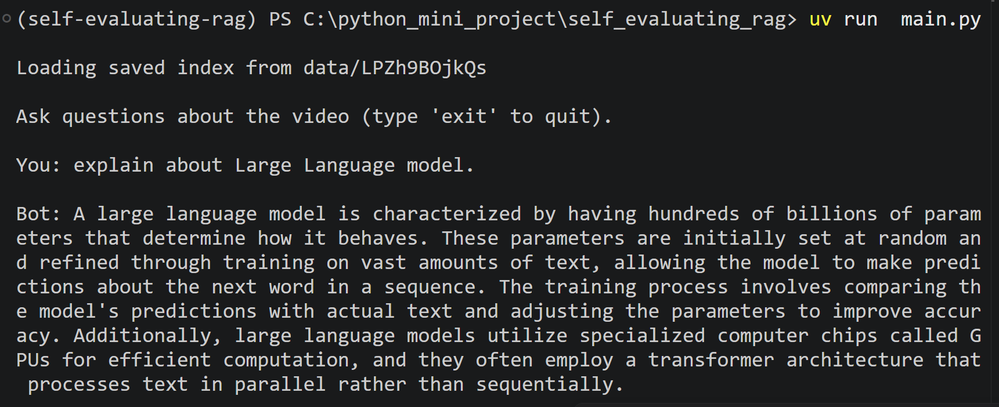
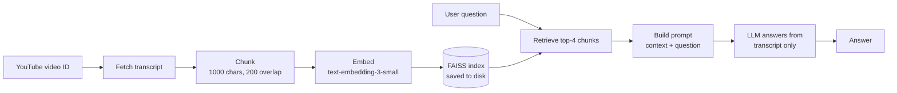

# TubeRAG: A Self-Evaluating YouTube Chatbot

Chat with any YouTube video that has English captions. Answers come only from the video's transcript, and every part of the pipeline (retriever, generator, full pipeline) is measured with an automated evaluation suite instead of "it seems to work".




## Why this project

Most RAG demos stop at "it answered my question". This one asks whether the answer is any good, and where it fails when it isn't. The chatbot is the product. The eval suite is what makes it trustworthy: it tests the retriever and the generator separately, so a bad score points at the component that caused it.

## How it works



| Step | Module | What it does |
|---|---|---|
| 1. Ingestion | `src/ingestion.py` | Fetches a video's transcript, or loads `.vtt` transcript files for evaluation |
| 2. Chunking | `src/chunking.py` | Recursive character splitting with overlap |
| 3. Embedding | `src/embedding.py` | OpenAI `text-embedding-3-small` for chunks and queries |
| 4. Vector store | `src/faiss_index.py` | Builds, saves and reloads a FAISS index so each video is indexed once |
| 5. Retrieval | `src/retriever.py` | Top-k similarity search |
| 6. Augmentation | `src/context_builder.py` | Joins chunks and fills the prompt template |
| 7. Generation | `src/generator.py` | Calls the LLM with the augmented prompt |
| 8. Chain | `src/chains.py` | Retrieval, prompt, LLM and output parser as one LangChain pipeline |

The prompt tells the model to use only the transcript, answer directly, clean up speech-to-text errors, say what the video does not cover, and reply with "I don't know based on this video." when the answer isn't there.

## Evaluation

The suite uses [DeepEval](https://github.com/confident-ai/deepeval) with `gpt-4o-mini` as the judge (threshold 0.7). Each component is tested on its own:

| Eval | File | Metrics | Golden set |
|---|---|---|---|
| Retriever | `evals/eval_retriever.py` | Contextual Recall, Contextual Precision | `goldens/retriever_goldens.json` (15 questions) |
| Generator | `evals/eval_generator.py` | Faithfulness, Answer Relevancy | `goldens/faithfulness_dataset.json` (15 questions) |

The generator eval feeds the generator the known-good context instead of the retriever's output, so a low score is the generator's fault alone. Every run saves per-question scores and the judge's reasons to `result/`, and runs with missing scores are flagged `INCOMPLETE`.

### Results

Each row is the average of 2 runs on the same golden set (n=15).

**Retriever** (chunk 1000, overlap 200, k=4)

| Metric | Score |
|---|---|
| Contextual Recall | 0.90 |
| Contextual Precision | 0.88 |
| Pass rate (threshold 0.7) | 87% |

**Generator** (golden context fed directly)

| Setup | Faithfulness | Answer Relevancy |
|---|---|---|
| `gpt-6-luna`, original prompt | 0.88 | 0.89 |
| `gpt-5.6-luna`, original prompt | 0.89 | 0.89 |
| `gpt-6-luna`, prompt v2 (current) | 0.89 | 0.88 |

### Findings

- **Model choice didn't matter here.** `gpt-5.6-luna` scored the same as `gpt-6-luna` at about twice the price, so the cheaper model was kept.
- **Run-to-run noise is about 0.05.** The same setup scored 0.04 to 0.05 apart on repeat runs, so only gaps of about 0.07 or more were treated as real, and each setting was run twice.
- **Prompt v2 is a tie on scores.** It was kept because the answers are about 25% shorter and refusals are consistent.
- **The retriever fails on the same 3 questions every run.** One example: a question about regression testing returns four generic chunks from the wrong session, so the right chunk never reaches the generator. This points the next work at retrieval, not generation.
- **The golden set caps Faithfulness at about 0.88.** A few contexts mix up similar terms (MMLU vs MMLU Pro) or don't answer their question, which makes the judge unstable on those items.

### Limitations

- 15 golden questions per eval. One question moves a score by about 6.7 points.
- One judge model (`gpt-4o-mini`), so judge bias is not measured.
- Answer Relevancy penalizes a correct "I don't know", which lowers scores on questions the context can't answer.
- The retriever and generator evals are complete. The full-pipeline eval (`evals/eval_rag_pipeline.py`) is not yet updated to the current modules.

## Getting started

**Requirements:** Python 3.12, [uv](https://docs.astral.sh/uv/), an OpenAI API key.

```bash
git clone https://github.com/Dhruv06000/Self-Evaluating-RAG-System.git
cd Self-Evaluating-RAG-System
uv sync
```

Create a `.env` file in the project root:

```
OPENAI_API_KEY=your_key_here
```

**Chat with a video.** Set `VIDEO_ID` in `main.py` (the ID only, e.g. `LPZh9BOjkQs` from `youtube.com/watch?v=LPZh9BOjkQs`), then:

```bash
uv run python main.py
```

The first run builds and saves the index under `data/<VIDEO_ID>`. Later runs load it instantly.

**Run the evals** (these call the OpenAI API and cost money):

```bash
uv run python -m evals.eval_retriever
uv run python -m evals.eval_generator
```

To evaluate the retriever, put your own `.vtt` transcript files in `knowledge_base/` and point the golden questions at them. Delete `data/knowledge_base_index` whenever you change the chunk size or embedding model.

## Project structure

```
.
├── main.py                 # YouTube chat loop
├── src/                    # RAG pipeline, one module per step
├── evals/                  # eval scripts + shared harness
├── goldens/                # golden question sets
├── result/                 # saved eval runs (per-question scores and reasons)
├── docs/                   # screenshots
├── data/                   # saved FAISS indexes (gitignored)
└── knowledge_base/         # your .vtt transcripts for evals (gitignored)
```

## Roadmap

Planned, not built yet:

- **Retrieval upgrades**, tested one at a time against the baseline: MMR / larger k, hybrid BM25 + embeddings, a reranker.
- **Cited answers:** return the retrieved sources with every answer, and update the full-pipeline eval.
- **Timestamps** in chunk metadata, so answers can link to the moment in the video.
- **Chat memory** with history-aware query rewriting.
- **Wider input:** URL parsing, better error handling, Hindi transcripts, and a Whisper fallback for videos without captions.
- **Any document:** the same pipeline for PDF, Word, Markdown and web pages, with a common metadata schema for citations.
- **Browser extension:** a side panel on the YouTube page that chats with the video you're watching, backed by a FastAPI service.

## Tech stack

Python 3.12 · LangChain · OpenAI (embeddings and chat) · FAISS · DeepEval · youtube-transcript-api · uv

## History

The first version of this project was a PDF RAG with a plain-Python eval pipeline. It is preserved at the [`pdf-rag-v1`](https://github.com/Dhruv06000/Self-Evaluating-RAG-System/tree/pdf-rag-v1) tag.

## License

MIT. See [LICENSE](LICENSE).

## Author

**Dhruv Kumar** · [GitHub: Dhruv06000](https://github.com/Dhruv06000)
